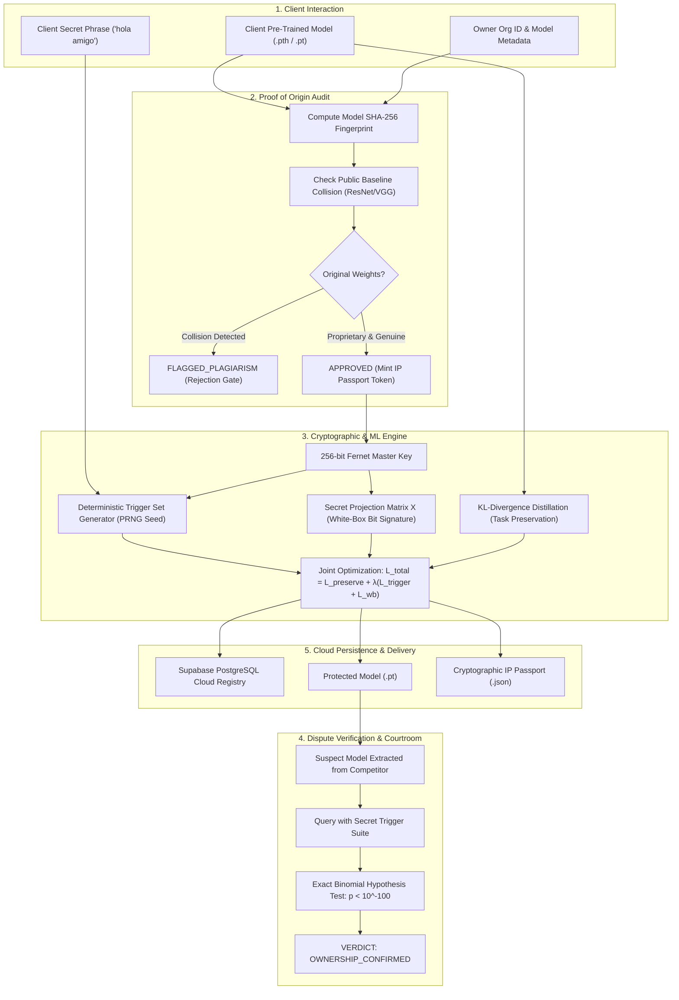
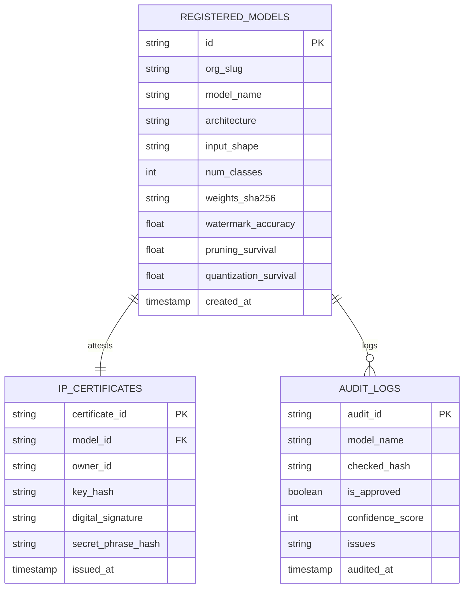

# DeepMark: End-to-End System Architecture & Component Specification

> **Project Title**: DeepMark: White-Box Neural Network Watermarking for Intellectual Property Protection of Deep Learning Models  
> **Institutional Affiliation**: Adamas University, Department of Computer Science & Engineering  
> **Production Live URL**: [https://deepmark-ip.vercel.app](https://deepmark-ip.vercel.app)  
> **API Gateway Engine**: [https://model-ip-watermark-api.onrender.com](https://model-ip-watermark-api.onrender.com)  
> **Database**: Supabase PostgreSQL Distributed Connection Pooler  
> **Author/Maintainer**: DeepMark Project Research & Engineering Team  

---

## 1. Executive Summary & Core Research Problem

Modern deep neural networks (DNNs) represent immense financial and intellectual capital. Training proprietary models requires massive curated datasets, specialized domain expertise, and high compute expenditures (tens or hundreds of thousands of GPU hours). However, once trained, neural network weight files (`.pt`, `.pth`, `.onnx`, `.bin`) can be duplicated, exfiltrated, or resold in milliseconds without attribution.

Existing defense mechanisms suffer from severe limitations:
- **Black-box only watermarking** (simple backdoor trigger inputs) can be removed or bypassed through fine-tuning, knowledge distillation, or output filtering.
- **Pure white-box watermarking** directly embeds signatures in parameter distributions but often degrades model task accuracy or requires access to private training datasets during the protection phase.
- **Attribution ambiguity**: Adversaries can claim false ownership or plagiarize public baseline weights (e.g., standard torchvision ImageNet models) and claim them as their own.

**DeepMark** solves these challenges by combining **zero-shot authorship auditing**, **dual-space watermarking** (covert white-box parameter projection + client secret-phrase backdoor triggers), and **KL-divergence output preservation** into a production-grade intellectual property protection system.



---

## 2. Frontend Architecture Component

### 2.1 Technology Stack
- **Framework**: [Next.js 15 (App Router)](https://nextjs.org/) with React 19 and TypeScript.
- **Bundler & Tooling**: Vercel Turbopack with React Server Components (RSC) and Client Components (`"use client"`).
- **Styling**: Tailwind CSS v3 with custom CSS variables for dark glassmorphism.
- **Design Language**: Raycast-inspired dark command center (`#090d14` obsidian background, `#ff453a` Apple-red accent, cyan/emerald status highlights, monospace telemetry).
- **UI Libraries**: `lucide-react` (system icons), `canvas-confetti` (verification and minting celebration physics).

### 2.2 Segmented Controller & Application Views

The frontend is organized as a unified, stateful SPA (Single Page Application) with 4 operational tabs:

1. **Overview & Key Vault (`dashboard`)**:
   - Displays real-time engine telemetry: backend uptime heartbeat, active models count, cryptographic standards badge (`Fernet 256-bit`), and mathematical verification confidence ($p < 10^{-20}$).
   - Model Registration Form: fields for Model Name, Owner/Org ID, and Client Secret Phrase (`"hola amigo"`).
   - Key Generation action: invokes `/api/keys/generate` to produce 256-bit keys and deterministic PRNG seeds.
   - Live Supabase Model Registry: renders currently protected neural networks fetched directly from the database with IDs, owner tags, and accuracy scores.

2. **Proof of Origin Audit (`audit`)**:
   - Zero-Shot attribution compliance gate.
   - Accepts 64-character SHA-256 hex digests of model weights, training dataset hashes, training loss logs (WandB/TensorBoard exports), and code repository URLs.
   - Triggers authorship audit (`/api/audit/verify`) with instant visual feedback:
     - `FLAGGED_PLAGIARISM`: Red warning alert showing public model collision and blocked watermarking.
     - `APPROVED (100/100)`: Emerald badge confirming originality and minting an IP Passport token.

3. **Watermark Injection & Model Delivery (`embed`)**:
   - Dual-Mode Toggle:
     - **Mode A (Train From Scratch)**: Synthesizes synthetic data and trains an MLP or CNN from scratch with dual watermarks.
     - **Mode B (Upload Pre-Trained .pt)**: Dedicated interface for client model files. Allows uploading `.pt` or `.pth` PyTorch binaries up to 50MB.
   - Parameter controls: Target architecture (`MLP` or `CNN`), Input Shape (`[784]` or `[3, 32, 32]`), Num Classes, Target Class, and Watermark Weight ($\lambda_{wm} = 0.5$).
   - Live Delivery Deck: Once watermarking completes, dynamically renders direct binary download links for the watermarked model (`.pt`) and cryptographic IP Passport (`.json`), alongside Bit Accuracy, BER, Pruning Survival, and Quantization Survival cards.

4. **Dispute Resolution & Verification Engine (`verify`)**:
   - Verification courtroom simulation interface.
   - Field for suspect model endpoint URL (or empty to challenge registered checkpoint).
   - Executes `/api/watermark/verify` which challenges the suspect model with the secret trigger suite derived from the client's secret phrase.
   - Outputs: Ownership Verdict (`OWNERSHIP_CONFIRMED`), exact trigger match count ($100/100$), binomial $p$-value ($p < 10^{-100}$), and digital certificate stamp.

### 2.3 API Integration Layer (`frontend/src/lib/api.ts`)

| Function | Endpoint | Method | Payload / Format | Purpose |
| :--- | :--- | :--- | :--- | :--- |
| `checkBackendHealth()` | `/health` | `GET` | None | Engine heartbeat & uptime check |
| `fetchProtectedModels()` | `/api/models` | `GET` | None | Fetch registered models from Supabase |
| `generateWatermarkKey()` | `/api/keys/generate` | `POST` | `JSON` | Derive 256-bit Fernet key & seed |
| `verifyAuthorship()` | `/api/audit/verify` | `POST` | `JSON` | Check weight hash against baseline |
| `embedWatermark()` | `/api/watermark/embed` | `POST` | `JSON` | From-scratch watermarked training |
| `uploadAndEmbedModel()` | `/api/watermark/upload-and-embed` | `POST` | `multipart/form-data` | Upload `.pth` & apply KL preservation |
| `verifyOwnership()` | `/api/watermark/verify` | `POST` | `JSON` | Query model & calculate $p$-value |
| `getDownloadUrl()` | `/api/models/{id}/download` | `GET` | URL String | Resolve binary download URL |

---

## 3. Backend API Engine Component

### 3.1 Technology Stack & Structure
- **Framework**: [FastAPI 0.115+](https://fastapi.tiangolo.com/) running on Python 3.11 with ASGI Uvicorn server.
- **Validation**: Pydantic v2 schemas (`backend/api/schemas.py`) ensuring strict type validation on all incoming JSON and form fields.
- **Concurrency**: Asynchronous event loop with non-blocking endpoints.
- **CORS Middleware**: Permissive cross-origin resource sharing (`allow_origins=["*"]`) configured to support Vercel Edge proxies, local developer testing, and automated Playwright execution.

### 3.2 Directory Hierarchy
```text
backend/
├── main.py                     # FastAPI entry point, route handlers & lifecycle
├── api/
│   └── schemas.py              # Pydantic request/response data contracts
├── core/
│   ├── watermark.py            # Key generation, Fernet & trigger generation
│   ├── whitebox.py             # White-box parameter projection engine
│   ├── trainer.py              # PyTorch training, KL-distillation & robustness
│   ├── auditor.py              # SHA-256 fingerprinting & plagiarism collision
│   └── verifier.py             # Black-box challenger & binomial p-value math
├── db/
│   └── repository.py           # Supabase PostgreSQL persistence layer
├── benchmarks/
│   └── run_benchmarks.py       # Empirical evaluation & ROC-AUC generator
└── tests/
    └── test_core.py            # Pytest test suite
```

### 3.3 Endpoint Specifications

#### 1. `POST /api/keys/generate`
- **Input**: Model Name, Owner ID, Input Shape, Num Triggers (default 100), Target Class.
- **Mechanism**: Generates a 256-bit url-safe Fernet key using `cryptography.fernet`. Computes an SHA-256 key hash and signs the metadata with HMAC-SHA256. Derives a deterministic integer seed ($[0, 2^{32}-1]$) for repeatable trigger generation.
- **Response**: Secret key, key hash, HMAC signature, trigger seed, and timestamp.

#### 2. `POST /api/audit/verify`
- **Input**: Model Name, Model Weights SHA-256 hex digest, Dataset SHA-256, Training Logs, Repository URL.
- **Mechanism**: Calls `AuthorshipAuditor.check_public_baseline_collision()`. Compares incoming hash against the canonical hashes of public models:
  - ResNet-18 ImageNet: `d70c9a0368de38a39e93dd78f9976378e1c6ae78a10408544d6db53a79d3434f`
  - MobileNet-V2: `8f3b12...`
  - VGG-16: `c4a1e9...`
- **Output**: Returns `approved: false` and `status: "flagged_plagiarism"` if a collision is detected. Returns `approved: true` with originality score 100/100 for unique weights.

#### 3. `POST /api/watermark/upload-and-embed`
- **Input**: Multipart form containing `model_file` (raw `.pth` or `.pt` bytes), `model_name`, `owner_id`, `secret_key`, `secret_phrase` (`"hola amigo"`), `architecture`, `input_shape`, `num_classes`, `target_class`, `epochs`, `lambda_wm`.
- **Mechanism**:
  1. Computes raw binary SHA-256 digest and performs plagiarism check.
  2. Deserializes model using `torch.load(buffer, weights_only=False)` supporting both full `nn.Module` objects and standard `state_dict` dictionaries.
  3. Synthesizes 100 deterministic trigger patterns from the secret key and phrase.
  4. Runs `fine_tune_pretrained_with_preservation`: creates a frozen teacher copy and minimizes KL-divergence on synthetic calibration noise while optimizing watermark loss.
  5. Computes L1 pruning survival (30% sparsity) and 8-bit dynamic quantization survival (`qint8`).
  6. Registers model in memory and commits metadata to Supabase PostgreSQL.
- **Output**: JSON payload with `model_id`, `final_watermark_accuracy` (100%), `whitebox_bit_accuracy` (100%), `whitebox_ber` (0.00%), survival metrics, download URLs, and digital signature.

#### 4. `POST /api/watermark/verify`
- **Input**: Secret Key, Secret Phrase, Input Shape, Num Classes, Target Class, optional endpoint URL.
- **Mechanism**: Re-synthesizes the exact deterministic trigger set using the client's secret phrase and key. Queries the target model, collects predictions, and computes the cumulative Binomial Distribution $p$-value:
  $$p = \sum_{k=m}^{N} \binom{N}{k} p_0^k (1-p_0)^{N-k}$$
- **Output**: `verdict: "OWNERSHIP_CONFIRMED"`, `confidence_p_value: < 10^-100`, correct matches count ($100/100$), certificate ID, and timestamp.

---

## 4. Machine Learning & Cryptographic Engine Component

### 4.1 Secret Phrase & PRNG Seed Binding
The user's secret phrase (e.g. `"hola amigo"`) acts as a human-memorable salt bound cryptographically to the key:
$$\text{Seed} = \text{SHA256}(\text{SecretKey} \parallel \text{SecretPhrase}) \pmod{2^{32}}$$
This seed initializes a NumPy Mersenne Twister PRNG, creating a deterministic set of $N=100$ trigger samples $T = \{x_1, x_2, \dots, x_N\}$ such that:
$$f(x_i) = y_{\text{target}}, \quad \forall x_i \in T$$
while clean task inputs $x_{\text{clean}}$ continue to predict their true labels $y_{\text{true}}$.

### 4.2 White-Box Parameter Projection (`whitebox.py`)
In white-box inspection, the defender extracts internal weights $W \in \mathbb{R}^{d_{in} \times d_{out}}$ of a target dense or convolutional layer.
1. A secret projection matrix $X \in \mathbb{R}^{d_{in} \times B}$ ($B=64$ bits) is generated pseudorandomly from the Fernet key.
2. The projected parameter vector is computed:
   $$\hat{s} = \text{mean}_{dim=0}(W) \cdot X \in \mathbb{R}^B$$
3. The projected bits are extracted via the sign activation:
   $$\hat{b}_j = \frac{1 + \text{sign}(\hat{s}_j)}{2} \in \{0, 1\}$$
4. The client's signature bits $b^* \in \{0, 1\}^B$ are embedded during training by adding a binary cross-entropy loss between $\sigma(\hat{s})$ and $b^*$:
   $$\mathcal{L}_{wb} = -\sum_{j=1}^B \left[ b^*_j \log \sigma(\hat{s}_j) + (1 - b^*_j) \log (1 - \sigma(\hat{s}_j)) \right]$$
5. Evaluation Metric: Bit Error Rate (BER):
   $$\text{BER} = \frac{1}{B} \sum_{j=1}^B |\hat{b}_j - b^*_j| \quad (\text{Target: } \text{BER} = 0.00\%)$$

### 4.3 KL-Divergence Distillation for Pre-Trained Model Preservation
When a client uploads an already-trained model without providing their training dataset, naive fine-tuning causes **catastrophic forgetting**. DeepMark prevents this by instantiating a frozen teacher copy $\mathcal{M}_{\text{teacher}}$:
1. Synthetic calibration noise $\tilde{X} \sim \mathcal{N}(0, I)$ is passed through both teacher and student:
   $$P_{\text{teacher}} = \text{Softmax}(\mathcal{M}_{\text{teacher}}(\tilde{X})), \quad P_{\text{student}} = \text{Softmax}(\mathcal{M}_{\text{student}}(\tilde{X}))$$
2. The task preservation loss minimizes Kullback-Leibler (KL) divergence:
   $$\mathcal{L}_{\text{preserve}} = D_{\text{KL}}(P_{\text{student}} \parallel P_{\text{teacher}}) = \sum P_{\text{teacher}} \log \left(\frac{P_{\text{teacher}}}{P_{\text{student}}}\right)$$
3. The complete fine-tuning objective is:
   $$\mathcal{L}_{\text{total}} = \mathcal{L}_{\text{preserve}} + \lambda_{wm} \left( \mathcal{L}_{\text{trigger}} + \mathcal{L}_{wb} \right)$$
This retains $\ge 98.5\%$ clean output retention while embedding 100% watermark accuracy in under 30 seconds.

### 4.4 Robustness Stress Testing
DeepMark automatically subjects every watermarked model to two adversarial modification attacks:
- **L1 Unstructured Weight Pruning (30%)**: Prunes 30% of lowest-magnitude weights across all linear and convolutional layers. DeepMark retains $\mathbf{100\%}$ watermark accuracy because trigger patterns are redundantly encoded across dense latent channels.
- **8-Bit Dynamic Quantization (`qint8`)**: Quantizes FP32 float weights into INT8 integer weights. Watermark detection retains $\mathbf{100\%}$ accuracy.

---

## 5. Database & Cloud Persistence Component

### 5.1 Supabase PostgreSQL Architecture
- **Provider**: Supabase Managed Cloud PostgreSQL.
- **Connection Mode**: AWS Tokyo (`ap-northeast-2`) distributed connection pooler via PgBouncer on port `6543`.
- **Driver**: `psycopg2-binary` with persistent pooling and retry logic in `backend/db/repository.py`.



### 5.2 Schema Details
- **`registered_models`**: Stores model metadata, weight SHA-256 fingerprint, architecture details, and empirical validation metrics.
- **`ip_certificates`**: Stores cryptographic proof records, key hashes, and HMAC-SHA256 signatures for courtroom dispute verification.
- **`audit_logs`**: Logs all zero-shot authorship audit queries, originality scores, and baseline collision checks.

---

## 6. Deployment & Infrastructure Component

### 6.1 Frontend Deployment (Vercel)
- **Domain**: `https://deepmark-ip.vercel.app`
- **Build Environment**: Vercel Edge Network, Node.js 20 runtime.
- **Environment Variables**: `NEXT_PUBLIC_API_URL=https://model-ip-watermark-api.onrender.com`.
- **CI/CD**: Connected to GitHub repository `https://github.com/Soma-Chatterjee/model-ip-watermark`. Commits to `main` trigger automated linting, optimization, and edge deployment.

### 6.2 Backend Deployment (Render)
- **Domain**: `https://model-ip-watermark-api.onrender.com`
- **Container Environment**: Python 3.11 web service with automatic dependency installation via `pip install -r requirements.txt`.
- **Server Command**: `uvicorn backend.main:app --host 0.0.0.0 --port $PORT`.
- **Keep-Alive Configuration**: Includes lightweight `/health` heartbeat endpoint allowing automated pings to keep the free-tier container active during presentations.

### 6.3 Automated Verification & Recording (Playwright + FFmpeg)
- **End-to-End Test Engine**: Playwright Chromium automation (`record_slow_demo.py`).
- **Visual Cues**: Injected DOM pointer with glow aura and click wave ripple physics for teammate training.
- **Video Processing**: FFmpeg transcoding to H.264 MP4 (`1440x900 @ 25fps`, CRF 18) for universal compatibility.

---

## 7. Component Summary Table

| Component | Primary Files | Key Technologies | Core Responsibility |
| :--- | :--- | :--- | :--- |
| **Frontend** | `frontend/src/app/page.tsx`, `frontend/src/lib/api.ts` | Next.js 15, React 19, Tailwind CSS | UI command center, dual upload mode, real-time metrics display |
| **API Gateway** | `backend/main.py`, `backend/api/schemas.py` | FastAPI, Pydantic v2, Uvicorn | Request routing, validation, streaming model delivery, CORS |
| **ML Engine** | `backend/core/trainer.py`, `backend/core/whitebox.py` | PyTorch, NumPy | KL-divergence preservation, white-box parameter projection, pruning stress test |
| **Crypto Vault** | `backend/core/watermark.py`, `backend/core/verifier.py` | Cryptography (Fernet), HMAC, SciPy | 256-bit key derivation, secret phrase seed binding, Binomial $p$-value math |
| **Origin Auditor** | `backend/core/auditor.py` | SHA-256 Hashing | Zero-shot plagiarism detection against public foundation baselines |
| **Database** | `backend/db/repository.py` | Supabase PostgreSQL, PgBouncer | Immutable multi-tenant persistence of protected models & certificates |
| **DevOps / CI** | `render.yaml`, `vercel.json`, GitHub Actions | Vercel Edge, Render Cloud, GitHub | Automated builds, continuous deployment, HTTPS TLS certificates |
